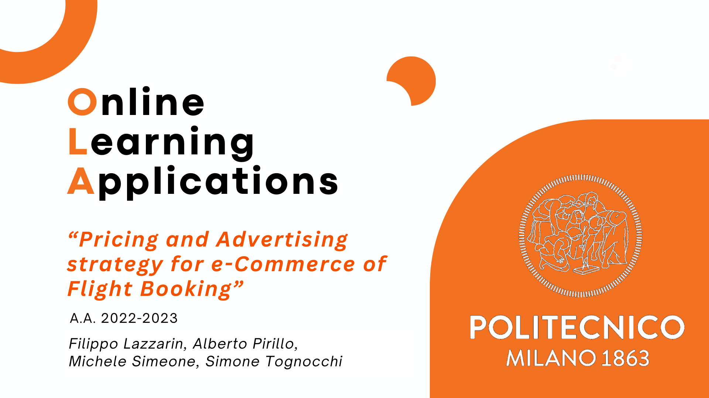
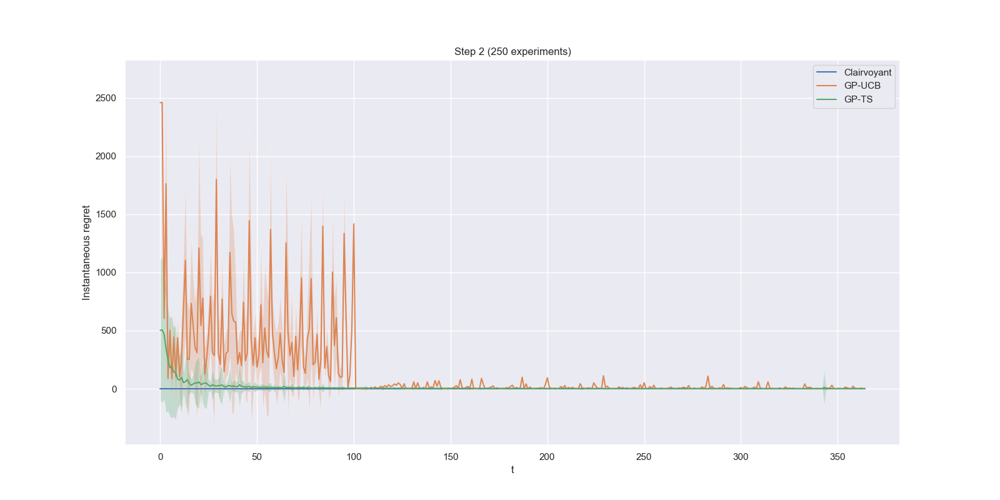
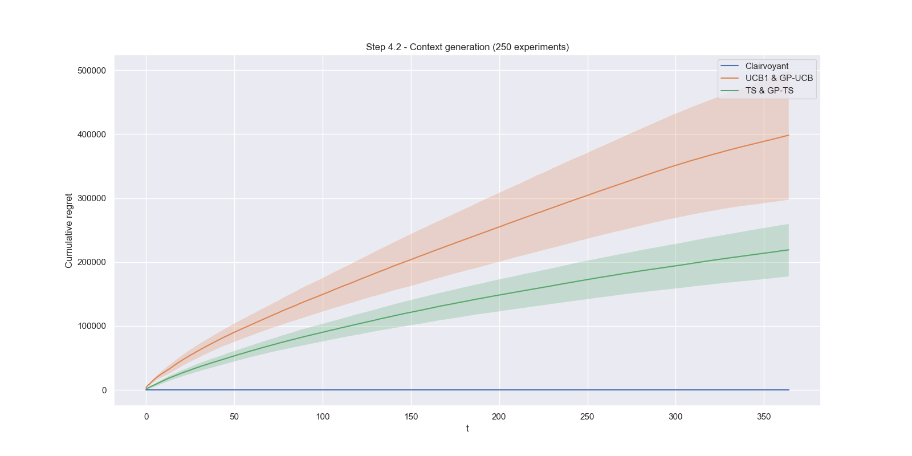
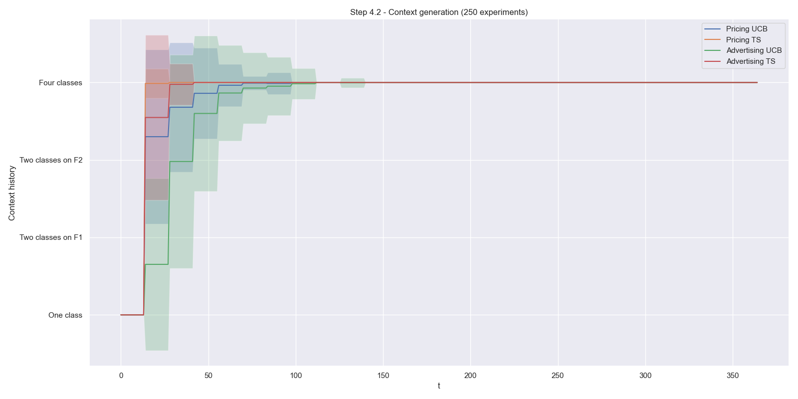
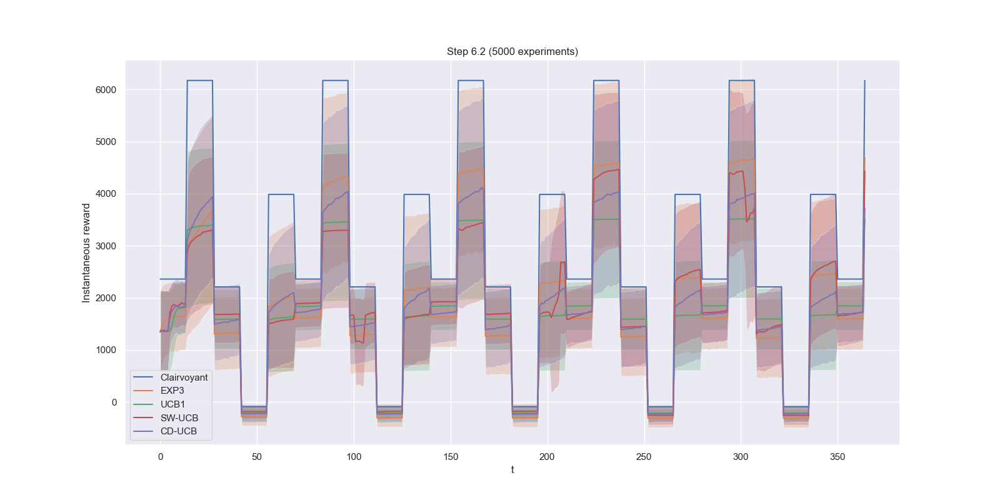

# OLA - Precios y Publicidad

## Descripción
En este proyecto desarrollamos una estrategia de marketing para el sitio web de comercio electrónico de una aerolínea, basada en algoritmos de Brazos Múltiples (MAB).

Existen dos posibles optimizaciones:
- **Estrategia de precios:** la empresa desea aprender el mejor precio para vender sus boletos, maximizando el producto del precio del boleto y la tasa de conversión correspondiente
- **Estrategia de publicidad:** la empresa desea desarrollar una campaña publicitaria para que un publicador muestre algunos anuncios a los clientes potenciales. La empresa quiere aprender la puja óptima a utilizar, que es la cantidad máxima que está dispuesta a pagar al publicador por cada clic

## Configuración
El proyecto se desarrolló y probó utilizando Python 3.11.

Clona el repositorio e instala todos los paquetes requeridos con:

    pip install -r requirements.txt

## Entorno
El entorno que utilizamos para las simulaciones está compuesto por 3 **clases** de usuarios:
- Menores de 25 años
- Adultos con edad en el rango de 25-40 años
- Mayores de 40 años

Los usuarios se distinguen por dos **características**:
- Si eligen comprar equipaje facturado
- Si compran un boleto de primera clase

El mercado de vuelos se ve afectado por la **estacionalidad**, lo que a su vez influye en las tasas de conversión:
- El período de invierno, en el que las tasas de conversión son medias
- El período de primavera, caracterizado por tasas de conversión más bajas
- El período de verano, que presenta tasas de conversión muy altas

## Algoritmos
A continuación se presentan los algoritmos que implementamos para aprender la **solución** **óptima** del entorno en las diversas simulaciones:
- UCB1
- Thompson Sampling
- Gaussian Process UCB (GP-UCB)
- Gaussian Process TS (GP-TS)
- Sliding Window UCB1 (SW-UCB1)
- Change Detection UCB1 (CD-UCB1)
- EXP3

## Simulaciones
A continuación se presentan los diferentes **escenarios** del **entorno** en los que ejecutamos las simulaciones:
1. Aprendizaje para **precios**: se aprende la estrategia de precios, la estrategia de publicidad es conocida
2. Aprendizaje para **publicidad**: se aprende la estrategia de publicidad, la estrategia de precios es conocida
3. Aprendizaje para **precios y publicidad conjuntos**: ambas estrategias deben ser aprendidas
4. Contextos y su **generación**: se ejecuta un algoritmo de generación de contextos para determinar cuántos contextos existen en los entornos y cuándo es factible cambiar de un aprendiz agregado a aprendices dedicados por clase
5. Manejo de entornos no estacionarios con **dos cambios abruptos**: la estrategia de precios debe aprenderse en un entorno en el que la solución óptima cambia con el tiempo
6. Manejo de entornos no estacionarios con **muchos cambios abruptos**: como el paso 5, pero con más fases y una frecuencia de cambio muy alta

## Resultados
Aquí presentamos algunos de los resultados de nuestras simulaciones. Para una vista completa de los resultados, consulte la [presentación](presentation/complete%20presentation.pdf) y todos los [gráficos](plots) que generamos.

El **arrepentimiento instantáneo** de GP-UCB y GP-TS en el paso 2, que eventualmente converge a la solución óptima:

Los resultados del algoritmo de generación de contextos en el paso 4, que logra un **arrepentimiento acumulativo logarítmico** y un rendimiento muy cercano al escenario en el que los contextos se conocen de antemano:

La evolución de la **elección del contexto** del algoritmo de generación de contextos durante la simulación:

La **recompensa instantánea** de EXP3 y de los demás algoritmos en el paso 6:

## Software
- [NumPy](https://numpy.org/)
- [Scikit-learn](https://scikit-learn.org/stable/index.html)
- [Matplotlib](https://matplotlib.org)
- [Seaborn](https://seaborn.pydata.org)
- [Python](https://www.python.org/)
- [PyCharm](https://www.jetbrains.com/pycharm/)

## Licencia
Licenciado bajo la [Licencia MIT](LICENSE)
